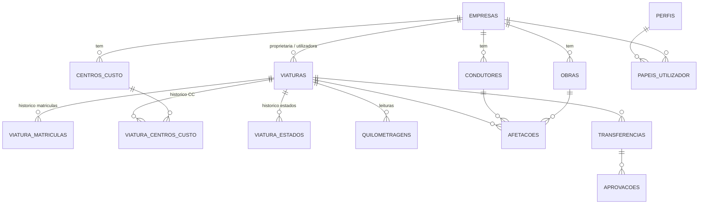

# FleetControl Adaúfe — Análise, Arquitetura e Plano de Desenvolvimento

| | |
|---|---|
| Versão | 0.1 — proposta para validação |
| Data | 12/10/2026 |
| Estado | **A aguardar validação.** Ainda não foi escrito código. A Fase 1 só arranca depois de validados este documento e as decisões da secção 10.1. |

---

## 1. Síntese da análise

A aplicação assenta em três pilares que condicionam todas as decisões técnicas:

1. **Cadastro e afetações temporais**: empresas, centros de custo, obras, condutores, viaturas e quem/onde cada viatura esteve em cada momento.
2. **Operação**: pedidos, transferências, alugueres, manutenções, imobilizações, sinistros, entregas e devoluções, cartões.
3. **Histórico bitemporal e validação mensal**: saber *o que aconteceu* numa data (tempo efetivo) e *o que o sistema sabia* numa data (tempo de conhecimento), e congelar versões mensais validadas.

O pilar 3 não pode ser acrescentado no fim: tem de estar no modelo de dados desde a primeira migration. Por isso a auditoria, o versionamento e os períodos temporais entram todos na Fase 1.

### 1.1 Dependências entre módulos

```
Utilizadores/Permissões ─┐
                         ▼
Empresas ──► Centros de custo ─┐
   │                           ├──► Viaturas ──► Quilometragens
   ├──► Obras/Instalações ─────┤        │
   └──► Condutores ────────────┘        ▼
                                   Afetações ──► Transferências/Cedências
                                        │
        ┌───────────────┬───────────────┼──────────────┬──────────────┐
        ▼               ▼               ▼              ▼              ▼
     Pedidos       Alugueres      Manutenções    Imobilizações    Sinistros
        │          (prolong.,      (Ação A/B,         │               │
        │          substit.)        oficinas)◄────────┴───────────────┘
        └───────────────┴───────────────┬──────────────┘
                                        ▼
                     Histórico mensal ──► Validação mensal (versões)
                                        ▼
                           Exportações / Relatórios / Alertas

Transversal desde a Fase 1: auditoria, versões, documentos (anexos), permissões.
```

---

## 2. Potenciais problemas e riscos

| # | Problema | Impacto | Proposta |
|---|---|---|---|
| R1 | **Estado operacional armazenado e derivado em simultâneo.** "Afeta" depende de existir afetação ativa; "Em manutenção" depende de uma manutenção em oficina; "Imobilizada" depende de uma imobilização aberta. Se o estado for editável à mão, diverge dos registos. | Estados incoerentes, dashboard errado. | O estado só muda através de funções de domínio (nunca por edição direta). Cada mudança fica em `viatura_estados` com período efetivo. A matriz de transições permitidas fica numa **tabela configurável**, não em código, porque as regras de compatibilidade não estão definidas (ver 10.2). |
| R2 | **Viaturas alugadas.** O aluguer tem matrícula, centro de custo, obra e condutor. | Lacunas nas afetações, quilometragens e sinistros de viaturas alugadas. | **Decidido (10.1):** as viaturas alugadas ficam só no módulo de alugueres. O aluguer guarda o seu próprio histórico de obra e condutor, e os sinistros e imobilizações podem referir um aluguer. |
| R3 | **Validação mensal vs. correções retroativas.** Um registo retroativo (ex.: manutenção de setembro registada em outubro) pode cair num mês já validado. | A versão validada deixaria de corresponder aos dados. | As versões validadas são *snapshots* imutáveis com *hash*. Uma escrita cujo período efetivo toque num mês validado dessa empresa é **rejeitada** até o mês ser reaberto, o que segue o que o documento pede ("processo de reabertura autorizado"). |
| R4 | **Empresa proprietária ≠ empresa utilizadora.** É preciso decidir quem vê a viatura e em que validação mensal entra. | Cruzamento de dados entre empresas. | A viatura fica visível às duas empresas. As afetações pertencem à empresa utilizadora. **A confirmar (10.2).** |
| R5 | **Fusos horários e mudança de hora.** Os meses em Europe/Lisbon têm dias de 23 h e de 25 h. | Registos perdidos ou duplicados nas fronteiras dos meses. | Guardar sempre `timestamptz`. Os limites dos meses são calculados em `Europe/Lisbon` por uma única função SQL, que é testada. |
| R6 | **Quilometragens fora de ordem.** Leituras retroativas, erros de digitação, substituição de conta-quilómetros. | Alertas de revisão errados. | Tabela própria de leituras. A quilometragem atual é a da leitura com **data de leitura** mais recente, e não a da última leitura introduzida. Leituras incoerentes ficam assinaladas e a correção exige motivo. |
| R7 | **Dados pessoais** (condutores, cartas, multas, geolocalização Cartrack). | RGPD e direito laboral. | Minimização de dados e acesso por perfil. A carta de condução e as multas só ficam visíveis a perfis autorizados. Não é implementada geolocalização individual sem avaliação de impacto (AIPD) e parecer jurídico. |
| R8 | **Ambiente de desenvolvimento.** Neste posto só está instalado o Git. Não existem Node.js nem Docker. | Não é possível executar a aplicação nem a base de dados local. | Instalar o Node.js 22 LTS e o Docker Desktop, ou usar um projeto Supabase Cloud de desenvolvimento (10.1). |
| R9 | **Dados reais antes da segurança.** Existem ficheiros Excel reais (ex.: `Projeto Cartrack/revest_condutores.xlsx`). | Exposição de dados. | Até ao fecho da Fase 1 usam-se apenas dados fictícios (*seeds*). A importação de dados reais só acontece depois de validados a autenticação, o RLS e os testes de permissões. |
| R10 | **A matrícula muda** (viatura nova sem matrícula, rematrícula). | O histórico ficaria associado à matrícula errada. | A viatura é identificada por um UUID interno e um código interno legível (ex.: `VT-000123`). As matrículas ficam numa tabela histórica com período de validade. |
| R11 | **Concorrência.** Dois utilizadores podem afetar a mesma viatura ao mesmo tempo. | Afetações sobrepostas. | *Exclusion constraint* PostgreSQL (`btree_gist`), garantida pela base de dados e não apenas pela interface. |
| R12 | **Aprovadores não definidos** em pedidos, prolongamentos, orçamentos de manutenção, validação e reabertura mensal. | Workflows incompletos. | Motor de aprovações genérico, com o aprovador exigido **parametrizável** por tipo de processo. Não se inventam regras: até haver resposta, ficam configurados os valores indicados em 10.2. |
| R13 | **Estados dependentes do tempo** ("A terminar" no aluguer). | Um estado guardado fica desatualizado. | "A terminar" é um estado **calculado** (fim previsto ≤ hoje + 7 dias), apresentado como estado mas não guardado. O mesmo se aplica a "Fim ultrapassado". |

---

## 3. Arquitetura técnica

### 3.1 Stack proposta

| Camada | Tecnologia | Justificação |
|---|---|---|
| Frontend + servidor web | **Next.js 15 (App Router) + React 19 + TypeScript** | Server Components e Server Actions: as chamadas à base de dados correm no servidor e nenhum segredo chega ao browser. |
| UI | **Tailwind CSS + shadcn/ui + TanStack Table** | Tabelas com ordenação, paginação e filtros do lado do servidor. |
| Formulários | **React Hook Form + Zod** | Um único esquema Zod valida no cliente e no servidor. |
| Base de dados | **PostgreSQL 15+** (via Supabase) | Integridade referencial, `tstzrange`, *exclusion constraints*, RLS, transações. Extensões: `btree_gist`, `pgcrypto`, `postgis` (geofences). |
| Backend / BaaS | **Supabase**: Auth, Storage, PostgREST, RLS | Permissões efetivas na base de dados (RLS) e documentos em *buckets* privados com URLs assinados. |
| Regras críticas | **Funções PL/pgSQL transacionais** (RPC) | Mudar uma afetação, executar uma transferência, validar um mês: cada operação é uma única transação atómica na base de dados. |
| Datas | `date-fns` + `date-fns-tz` | Formato DD/MM/AAAA, fuso Europe/Lisbon. |
| Excel | **ExcelJS** (servidor) | Importação e exportação. Evita-se o pacote `xlsx` do npm, que está desatualizado e tem vulnerabilidades conhecidas. |
| PDF | **@react-pdf/renderer** (servidor) | Relatórios com cabeçalho de período, filtros, data de emissão e versão. |
| Testes | **pgTAP** (base de dados, RLS, regras temporais) · **Vitest** (lógica TS) · **Playwright** (E2E) | Os testes de regras de negócio e permissões correm diretamente contra o PostgreSQL. |
| Migrations | **Supabase CLI** (SQL versionado) | Cada alteração ao esquema é um ficheiro SQL no Git. |

**Princípio de portabilidade:** as regras de negócio vivem em SQL standard do PostgreSQL (constraints, funções, RLS). Se o grupo exigir alojamento interno, a mesma base de dados corre em Supabase *self-hosted* ou num PostgreSQL gerido (Azure). Só a camada de autenticação teria de ser adaptada.

### 3.2 Diagrama

```
Browser (React, sem segredos)
   │  HTTPS, cookie de sessão
   ▼
Next.js (servidor) ── Server Actions / Route Handlers
   │   • valida com Zod
   │   • chama RPC com o JWT do utilizador (RLS aplica-se)
   │   • service_role APENAS em jobs/imports no servidor, nunca exposto
   ▼
PostgreSQL (Supabase)
   ├─ schema app        domínio (tabelas, funções de negócio)
   ├─ schema hist       versões anteriores (tempo de conhecimento)
   ├─ schema audit      eventos de auditoria (diffs, motivo, origem)
   ├─ schema iam        perfis, papéis por empresa
   ├─ schema importacao lotes e linhas de importação
   ├─ schema integracao geofences, staging Cartrack (vazio até haver API)
   └─ RLS em todas as tabelas expostas
Storage (buckets privados): documentos, fotografias, ficheiros importados
Jobs agendados (pg_cron): recalcular alertas, estados temporais
```

### 3.3 Segurança

- RLS ativo em todas as tabelas. Sem políticas significa sem acesso.
- `DELETE` revogado nas tabelas de domínio. Usa-se anulação com motivo.
- Funções `SECURITY DEFINER` apenas onde é indispensável, com `search_path` fixo e verificação explícita de permissões.
- Documentos em *buckets* privados, acesso por URL assinado de curta duração e políticas de Storage por empresa.
- Não se guardam PINs de cartões nem credenciais.
- Cabeçalhos de segurança (CSP), *rate limiting* no login e MFA (ou SSO corporativo, ver 10.1).

### 3.4 Ambientes, backups e recuperação

- **Local** (Supabase CLI + Docker) → **Staging** → **Produção**, cada um com o seu projeto e as suas chaves.
- Região UE (Frankfurt ou outra da UE).
- Backups: PITR do Supabase (plano Pro ou superior) mais um `pg_dump` diário cifrado exportado para armazenamento do grupo. Fica documentado um **teste de reposição trimestral**.

### 3.5 Estrutura do repositório

```
fleetcontrol-adaufe/
├─ docs/                    documentação técnica e funcional (este ficheiro, ADRs, manual)
├─ supabase/
│  ├─ migrations/           SQL versionado
│  ├─ tests/                pgTAP
│  └─ seed.sql              dados FICTÍCIOS
├─ src/
│  ├─ app/(auth)/ (app)/    rotas Next.js por módulo
│  ├─ components/           UI partilhada (shadcn)
│  ├─ modules/<modulo>/     esquemas Zod, actions, queries, componentes do módulo
│  ├─ lib/                  datas/fuso, formatação pt-PT, cliente Supabase servidor
│  └─ types/                tipos gerados da base de dados
├─ tests/e2e/               Playwright
└─ .github/workflows/       CI (lint, typecheck, pgTAP, Vitest, Playwright)
```

---

## 4. Modelo relacional

**Convenções:** PK `id uuid`; nomes do domínio em português, sem acentos (`viaturas`, `afetacoes`); `empresa_id` em todas as tabelas operacionais (base do RLS); colunas de auditoria em todas as tabelas: `criado_em`, `criado_por`, `atualizado_em`, `atualizado_por`, `sys_period tstzrange` (tempo de conhecimento); `periodo tstzrange` ou `data_efetiva` (tempo efetivo) onde aplicável; `anulado_em`, `anulado_por` e `motivo_anulacao` em vez de `DELETE`.

### 4.1 Identidade e permissões (Fase 1)

| Tabela | Campos principais | Regras |
|---|---|---|
| `iam.perfis` | id (= auth.users.id), nome, email, ativo, condutor_id? | 1:1 com o utilizador autenticado |
| `iam.papeis_utilizador` | utilizador_id, papel (enum), empresa_id (NULL = todas), valido_de, valido_ate | Os papéis são **por empresa**. A Administração e o Administrador podem ter `empresa_id` NULL |

Enum `papel`: `administrador`, `coordenador_frota`, `gestor_un`, `controller`, `administracao`, `condutor`.

### 4.2 Cadastro (Fase 1)

| Tabela | Campos principais | Regras |
|---|---|---|
| `empresas` | codigo (único), designacao, gestor_un_id → perfis, ativa | Desativar não apaga nada |
| `empresa_responsaveis` | empresa_id, utilizador_id, funcao, periodo | Responsáveis autorizados, com histórico |
| `centros_custo` | empresa_id, codigo, designacao, ativo | `UNIQUE (empresa_id, codigo)`. O mesmo código pode existir noutra empresa |
| `obras` | empresa_id, codigo, designacao, localizacao, responsavel, estado, data_inicio, data_conclusao | `UNIQUE (empresa_id, codigo)`. O histórico mantém-se depois da conclusão |
| `condutores` | empresa_id, codigo_interno, nome, contacto_profissional, categorias_carta[], validade_carta, ativo | Campos sensíveis com acesso restrito |
| `condutor_formacoes` | condutor_id, designacao, data, validade | |
| `fornecedores` | nome, tipo (`rent_a_car`, `oficina`, `outro`), contactos | Partilhado entre módulos |
| `viaturas` | codigo_interno (`VT-000001`, único), empresa_proprietaria_id, empresa_utilizadora_id, marca, modelo, versao, tipologia, lotacao, combustivel, ano, tipo_propriedade, data_entrada_frota, data_saida_frota, **sem matrícula obrigatória** | A matrícula atual é obtida de `viatura_matriculas` |
| `viatura_matriculas` | viatura_id, matricula, periodo, provisoria (bool) | Uma matrícula ativa por viatura (*exclusion*) e uma viatura por matrícula ativa |
| `viatura_centros_custo` | viatura_id, centro_custo_id, periodo, motivo | Histórico de CC. O CC tem de pertencer à empresa correta (trigger). **Mudar a obra não altera o CC** |
| `viatura_estados` | viatura_id, estado (enum), periodo, origem (entidade + id), motivo | *Exclusion*: um único estado em cada instante |
| `estado_transicoes` | de_estado, para_estado, permitido | Matriz configurável (R1) |
| `quilometragens` | viatura_id, km, lida_em (tempo efetivo), registado_em, origem (`manual`, `manutencao`, `afetacao`, `importacao`, `cartrack`), entidade_origem, coerente (bool), motivo_correcao | Ver 5.7 |
| `movimentos_frota` | viatura_id, tipo (`entrada`, `saida`), data, motivo, empresa_id | Entradas e saídas da frota |

### 4.3 Afetações e transferências (Fase 1)

| Tabela | Campos principais | Regras |
|---|---|---|
| `afetacoes` | viatura_id, empresa_id, centro_custo_id (fotografia do CC no início), condutor_id?, obra_id?, periodo tstzrange, km_inicial, km_final, registado_por, observacoes, retroativa (bool), motivo | `EXCLUDE USING gist (viatura_id WITH =, periodo WITH &&) WHERE (anulado_em IS NULL)` |
| `transferencias` | tipo (`cedencia_temporaria`, `transferencia_definitiva`), viatura_id, empresa_origem_id, empresa_destino_id, motivo, data_inicio, data_fim_prevista, estado, proposto_por, executado_por/em | Execução apenas por função que verifica as aprovações |
| `aprovacoes` | processo (tipo), processo_id, papel_exigido, empresa_id, decisao (`aprovado`, `rejeitado`), decidido_por, decidido_em, comentario | **Só permite inserir (append-only)**. Uma decisão nova não apaga as anteriores |

### 4.4 Operação (Fases 2 e 4, previstas já no esquema)

| Tabela | Notas |
|---|---|
| `pedidos_viatura`, `pedido_eventos` | Workflow com 8 passos. Cada mudança de estado é um evento |
| `pedido_propostas` | Viatura interna proposta ou indicação de "aluguer externo via dst" |
| `alugueres` | matricula, marca, modelo, tipologia (dados próprios: **não** referem `viaturas`), empresa_id, centro_custo_id, fornecedor_id, referencia_contrato, inicio, fim_previsto, devolucao_efetiva, valor, periodicidade (`diaria`, `mensal`), estado, motivo, pedido_id? |
| `aluguer_afetacoes` | aluguer_id, obra_id, condutor_id, periodo. Mesmas regras de sobreposição que `afetacoes` |
| `aluguer_substituicoes` (nota) | Guarda as matrículas original e substituta como texto, porque a viatura alugada não está no cadastro |
| `aluguer_prolongamentos` | aluguer_id, fim_anterior, fim_novo, motivo, data_pedido, responsavel, estado_aprovacao. Append-only |
| `aluguer_substituicoes` | aluguer_id, viatura_original_id, viatura_substituta_id, data_substituicao, motivo, data_devolucao_substituta |
| `oficinas` | Extensão de `fornecedores`: localizacao, especialidades[], cobertura_geografica, rede (`dst`, `externa`, `rede_nacional`) |
| `manutencoes` | viatura_id, empresa_id, centro_custo_id, tipo (enum), descricao, data_pedido, data_agendamento, data_efetiva, oficina_id, km, valor_orcamentado, valor_aprovado, valor_final, entrada_oficina, saida_oficina, estado, **modo (`pedido`, `registo_retroativo`)**, sinistro_id? |
| `planos_preventivos` | viatura_id, tipo (`revisao`, `inspecao`), proxima_data, proximos_km, km_referencia, km_referencia_lida_em |
| `pneus_eventos` | viatura_id, tipo (`substituicao`, `rotacao`, `alinhamento`), data, km, posicoes, manutencao_id? |
| `imobilizacoes` | viatura_id, empresa_id, motivo, periodo, localizacao, oficina_id, previsao_resolucao, estado, viatura_substituicao_id, manutencao_id?, sinistro_id? |
| `sinistros` | viatura_id, empresa_id, condutor_id, data, tipo (`acidente`, `dano`), participacao_seguro, declaracao_amigavel, franquia, estado |
| `entregas_devolucoes` | tipo, viatura_id, condutor_id, empresa_id, data_hora, km, combustivel, limpeza, danos jsonb, equipamentos jsonb, confirmado_por/em, afetacao_id? |
| `cartoes_frota`, `cartao_atribuicoes` | Identificador (sem PIN), plafond, atribuição à viatura/responsável com período |
| `documentos`, `documento_ligacoes` | Ficheiro no Storage, tipo, validade. Liga-se a qualquer entidade (viatura, aluguer, manutenção…) |
| `multas` | condutor_id, viatura_id, data, descricao, estado. Acesso restrito |
| `tarefas`, `tarefa_eventos` | Tarefas manuais e geradas por alertas, com histórico |
| `alertas` (vista + tabela materializada por job) | Calculados a partir de regras e não introduzidos à mão |

### 4.5 Histórico, validação, importação, integração

| Tabela | Notas |
|---|---|
| `hist.<tabela>` | Cópia de cada versão anterior, com `sys_period` fechado (tempo de conhecimento) |
| `audit.eventos` | tabela, registo_id, operacao, valores_anteriores jsonb, valores_novos jsonb, campos_alterados[], utilizador_id, ocorrido_em (efetivo), registado_em, motivo, origem (`ui`, `importacao`, `api`, `sistema`), lote_importacao_id? |
| `validacoes_mensais` | empresa_id, ano, mes, estado (`por_validar`, `em_validacao`, `validado`, `reaberto`), versao_atual. `UNIQUE (empresa_id, ano, mes)` |
| `validacao_versoes` | validacao_id, versao, snapshot jsonb (todos os mapas mensais), hash_sha256, tempo_conhecimento (instante em que o snapshot foi gerado), validado_por, validado_em, observacoes. **Imutável** |
| `validacao_reaberturas` | validacao_id, reaberto_por, reaberto_em, motivo, versao_origem |
| `importacao.lotes`, `importacao.linhas` | Ficheiro, tipo, estado, contagens; cada linha com resultado (`novo`, `alteracao`, `duplicado`, `erro`) e mensagens |
| `integracao.geofences` | obra_id, geometria (PostGIS Polygon), ativa |
| `integracao.cartrack_*` | Reservado. Não é criado nem simulado até existir acesso autorizado à API |

### 4.6 Diagrama ER (núcleo da Fase 1)



---

## 5. Regras de histórico temporal

### 5.1 Dois eixos de tempo

| Eixo | Pergunta | Implementação |
|---|---|---|
| **Tempo efetivo** | "O que aconteceu em 15/09/2026?" | `periodo tstzrange` (afetações, alugueres, imobilizações, estados, CC, matrículas) ou `data_efetiva` (manutenções, leituras) |
| **Tempo de conhecimento** | "O que estava registado no sistema em 01/10/2026?" | `sys_period tstzrange` em cada linha. Um trigger copia a versão anterior para `hist.<tabela>` em cada `UPDATE` |

A reconstrução bitemporal faz-se assim: `SELECT … FROM (atual UNION ALL hist) WHERE sys_period @> :t_conhecimento AND periodo && :periodo_efetivo`, através da função `app.estado_frota(t_efetivo, t_conhecimento)`.

### 5.2 Regras invioláveis

1. Não existe `DELETE` em tabelas de domínio. Existe **anulação**, com motivo obrigatório.
2. Qualquer `UPDATE` a um registo crítico exige **motivo**. As funções RPC recebem `p_motivo` e o trigger rejeita a alteração se o motivo estiver vazio.
3. Cada alteração gera um `audit.eventos` com valor anterior, valor novo, utilizador, data do acontecimento, data de registo, motivo e origem.
4. As aprovações, os prolongamentos e as versões validadas só admitem inserção.

### 5.3 Sobreposição de períodos (consultas mensais)

- Mês M em Lisboa: `[início de M 00:00 Europe/Lisbon, início de M+1 00:00 Europe/Lisbon)`, calculado por `app.periodo_mes(ano, mes)`.
- Um registo aparece em M se `periodo && periodo_mes(M)`. Um período sem fim (`upper = NULL`) está em curso.
- **Período efetivo dentro do mês** = `periodo * periodo_mes(M)` (interseção).
- Consequência: uma afetação de agosto a outubro aparece em agosto, setembro e outubro, e um aluguer de setembro a novembro aparece nos três meses.
- Para o aluguer, o período relevante é `[inicio, coalesce(devolucao_efetiva, fim_previsto em vigor))`.

### 5.4 Afetações

- Não pode haver duas afetações ativas sobrepostas para a mesma viatura (*exclusion constraint*).
- Mudar o condutor ou a obra chama `app.mudar_afetacao(viatura, instante, novo_condutor, nova_obra, km, motivo)`. Numa só transação, a função fecha a afetação atual em `instante` e cria uma nova a partir de `instante`. Nunca altera a obra de uma afetação já existente.
- **Afetação retroativa** (com início no passado e a cruzar afetações existentes): a função divide os períodos afetados, guarda as versões anteriores em `hist` e marca `retroativa = true`. Requer o papel autorizado (ver 10.2).
- O CC da viatura fica guardado em cada afetação no momento em que é criada, para que os mapas mensais mostrem o CC em vigor nessa altura.

### 5.5 Matrículas e centros de custo

- Ambos com período de validade. A matrícula definitiva fecha a provisória sem perder a ligação histórica.
- Os mapas mensais mostram a matrícula e o CC **em vigor no período**, com a matrícula atual como referência.

### 5.6 Estado operacional

- `viatura_estados` com período. Cada transição é validada contra `estado_transicoes`.
- As transições automáticas acontecem só por eventos de domínio: abrir uma afetação passa a "Afeta", entrar em oficina passa a "Em manutenção", e assim por diante. A edição manual exige motivo e o papel Coordenador.

### 5.7 Quilometragens

- Cada leitura tem `lida_em` (momento efetivo) e `registado_em`.
- **Quilometragem atual** = leitura não anulada com o `lida_em` mais recente. Uma leitura antiga introduzida hoje **não** substitui a atual.
- **Incoerência**: uma leitura é incoerente se `km` for inferior ao de uma leitura anterior no tempo efetivo, ou superior ao de uma leitura posterior. Fica marcada `coerente = false`, gera um alerta e só é aceite com motivo.
- Os alertas de revisão e inspeção por km mostram sempre a **data da leitura usada** e assinalam leituras com mais de N dias (N configurável).

### 5.8 Manutenções retroativas (Ação B)

- `app.registar_intervencao_realizada(...)` cria a manutenção diretamente no estado "Concluída", com `modo = 'registo_retroativo'`, `data_efetiva`, `registado_em = now()`, km, valor, oficina e utilizador. Não passa pelo workflow de pedido.
- Cria também uma leitura de km com `lida_em = data_efetiva` e origem `manutencao`. Pela regra 5.7, essa leitura não altera a quilometragem atual se for antiga.
- No histórico mensal aparece no mês da `data_efetiva`, com a indicação **"Registo posterior (registado em DD/MM/AAAA)"** sempre que o registo foi feito num mês posterior ao da data efetiva.
- Uma correção a um registo retroativo é um `UPDATE` com motivo. A versão anterior fica em `hist.manutencoes`.

### 5.9 Validação mensal e bloqueio

- Ao validar, `app.validar_mes(empresa, ano, mes, observacoes)` gera o snapshot (mapas de afetações, alugueres, manutenções, imobilizações, transferências e movimentos), calcula o SHA-256 e guarda o tempo de conhecimento. Tudo numa transação.
- Com o mês validado, qualquer escrita de domínio cujo tempo efetivo intersete esse mês dessa empresa é **rejeitada** com a mensagem "Mês validado — requer reabertura".
- A reabertura (`app.reabrir_mes`) exige papel autorizado e motivo. Depois das correções, uma nova validação gera a versão N+1. A comparação entre versões é um *diff* dos snapshots.
- As versões guardadas nunca mudam.

---

## 6. Workflows de aprovação

Há um único motor: `aprovacoes` (append-only) mais a configuração `regras_aprovacao (processo, papel_exigido, ambito_empresa)`. Cada função de execução verifica as aprovações exigidas **na base de dados**, não só na interface.

### 6.1 Cedência temporária e transferência definitiva entre empresas

```
Proposta (Coordenador) ──► Aguarda aprovações
        ├── GUN empresa origem:  aprovar / rejeitar
        └── GUN empresa destino: aprovar / rejeitar
   ambas aprovadas ──► Aprovada ──► Executada (Coordenador, via app.executar_transferencia)
   qualquer rejeição ──► Rejeitada
   antes de executada ──► Cancelada (com motivo)
```

- Na execução, numa só transação: a afetação atual é fechada; a empresa utilizadora muda (cedência) ou mudam a empresa proprietária e a utilizadora (transferência); o CC é atualizado conforme 10.2; o estado e o movimento ficam registados.
- O Coordenador **não consegue** executar sem as duas aprovações. Isto é garantido pela base de dados e coberto por um teste pgTAP.
- Uma cedência temporária com fim previsto gera um alerta quando o fim se aproxima.

### 6.2 Pedidos de viatura

`Recebido → Em validação → Verificação de disponibilidade → Proposta → (Aguarda aprovação) → Em execução → Entregue → Concluído`, com ramos possíveis para `Rejeitado` e `Cancelado`.
- No passo 3 aparece a lista de viaturas internas "Disponíveis" compatíveis (tipologia e lotação) na empresa e no grupo.
- Quando a proposta é "aluguer externo", o pedido regista que a contratação segue via dst. O sistema apenas regista o aluguer resultante.
- **Quem valida no passo 2 e quando é necessária aprovação no passo 5: a confirmar (10.2).**

### 6.3 Alugueres

`Solicitado → A aguardar confirmação → Confirmado → Ativo → (Prolongado | Em substituição) → Devolvido`, e `Cancelado` a partir de qualquer estado anterior a "Ativo".
- "A terminar" e "Fim ultrapassado" são calculados (R13).
- Prolongamento: `Pedido → Aprovado/Rejeitado`. Só quando é aprovado muda o fim previsto em vigor. O histórico guarda todos os prolongamentos.

### 6.4 Manutenções (Ação A)

`Solicitada → A aguardar orçamento → Orçamento recebido → A aguardar aprovação → Aprovada → Agendada → Em oficina → (A aguardar peças) → Concluída`, e `Cancelada`.
- É possível avançar sem orçamento.
- O valor final só é obrigatório em "Concluída".
- Entrar em "Em oficina" pode abrir automaticamente uma imobilização (comportamento configurável).

### 6.5 Validação mensal

`Por validar → Em validação → Validado → (Reaberto → Em validação → Validado vN+1)`.

---

## 7. Matriz de permissões

Legenda: **L** ler · **C** criar · **E** editar/corrigir · **A** aprovar/decidir · **X** executar · — sem acesso.
Âmbito: (T) todas as empresas · (A) empresas autorizadas · (P) a própria empresa · (S) só os seus registos.

| Módulo | Administrador | Coordenador Frota | Gestor UN | Controller | Administração | Condutor |
|---|---|---|---|---|---|---|
| Empresas, utilizadores, parâmetros | LCE (T) | L (A) | L (P) | L (A) | L (T) | — |
| Centros de custo, obras | LCE (T) | LCE (A) | L (P) | L (A) | L (T) | — |
| Viaturas | LCE (T) | LCE (A) | L (P) | L (A) | L (T) | L (S) |
| Condutores (dados sensíveis) | LCE (T) | LCE (A) | L (P) ¹ | — ¹ | — ¹ | L (S) |
| Afetações | L (T) | LCE (A) | L (P) | L (A) | L (T) | L (S) |
| Afetações retroativas | E (T) | E (A) ² | — | — | — | — |
| Transferências / cedências | L (T) | C, X após aprovação (A) | **A** (P) | L (A) | L (T) | — |
| Pedidos | L (T) | LCE (A) | LC, **A** (P) ² | L (A) | L (T) | — |
| Alugueres, prolongamentos | L (T) | LCE (A) | L, A? (P) ² | L (A) | L (T) | L (S) |
| Manutenções (A e B) | L (T) | LCE (A) | L, A? (P) ² | L (A) | L (T) | — |
| Imobilizações, sinistros | L (T) | LCE (A) | L (P) | L (A) | L (T) | C ocorrência (S) |
| Entregas e devoluções | L (T) | LCE (A) | L (P) | L (A) | — | confirmação (S) |
| Cartões GALP | L (T) | LCE (A) | L (P) | L (A) | L (T) | — |
| Histórico mensal | L (T) | L (A) | L (P) | L (A) | L (T) | — |
| Validação mensal | L (T) | prepara (A) ² | **A** (P) ² | L (A) | L (T) | — |
| Reabertura de mês | **A** (T) ² | — ² | — ² | — | — | — |
| Auditoria | L (T) | L (A) | L (P) | L (A) | L (T) | — |
| Importações | X (T) | X (A) | — | — | — | — |

¹ Contactos, carta e multas visíveis apenas a quem gere os condutores (minimização).
² Valor proposto, **a confirmar em 10.2**. Todos estes valores são parâmetros em `regras_aprovacao` e `iam.papeis_utilizador`, e alterá-los não implica rever código.

Implementação: funções `iam.tem_papel(papel, empresa_id)` e `iam.empresas_acessiveis()` usadas em todas as políticas RLS. Cada célula da matriz tem um teste pgTAP que tenta a operação com um utilizador de cada perfil.

---

## 8. Ecrãs principais

| # | Ecrã | Conteúdo essencial |
|---|---|---|
| — | **Estrutura** | Menu lateral com os 22 itens; pesquisa global por matrícula ou código interno (Ctrl+K); seletor de empresa no topo; sino de alertas |
| 1 | Dashboard | Os 15 indicadores do ponto 22, filtráveis por empresa. Cada cartão abre a listagem já filtrada |
| 2 | Frota (lista) | Tabela com filtros (empresa, CC, estado, tipologia, obra, condutor), ordenação, paginação no servidor e exportação |
| 2a | **Ficha da viatura** | Cabeçalho com matrícula, código, estado, empresa, CC, condutor, obra e km (com data da leitura). Separadores: Resumo · **Linha cronológica** · Afetações · Alugueres · Manutenções · Imobilizações · Sinistros · Documentos · Quilometragens · Cartões · Auditoria |
| 3–6 | Empresas, CC, Obras, Condutores | Listas e fichas. A ficha da obra mostra as viaturas atuais e o seletor "viaturas afetas no mês…" |
| 7 | Afetações | Atuais e históricas, com as ações Atribuir, Mudar condutor/obra, Terminar e Registo retroativo |
| 8 | Pedidos | Quadro (kanban) por passo do workflow e ficha com a consulta de disponibilidade interna |
| 9 | Alugueres | **Mapa** com todos os filtros (incluindo mês e intervalo de datas, com lógica de sobreposição) e ficha com prolongamentos e substituições |
| 10 | Manutenções | Dois botões distintos: **"Solicitar manutenção"** e **"Registar intervenção realizada"**. Lista com orçamento, valor aprovado, valor final e diferença. Vista por viatura cronológica e por km |
| 11–17 | Oficinas, Inspeções/pneus, Imobilizações (com dias), Sinistros, Entregas/devoluções (checklist e comparação), GALP, Cartrack (estrutura e geofences) | |
| 18 | **Histórico mensal** | Seletor de mês/ano ou intervalo, filtros, e separadores por mapa (afetações, alugueres, manutenções com alternância pedido/efetiva, imobilizações, transferências, movimentos). Selos "Registo posterior" |
| 19 | Validações mensais | Grelha empresa × mês com estados; validar; reabrir; comparar versões |
| 20 | Alertas e tarefas | Área diária do Coordenador, com tarefas por prioridade e data limite |
| 21 | Relatórios | Catálogo de exportações Excel e PDF com cabeçalho de período, filtros, data de emissão e versão |
| 22 | Administração | Utilizadores, papéis por empresa, regras de aprovação, matriz de estados, parâmetros, auditoria, importações |

Formatação: datas DD/MM/AAAA, horas 24 h, `1.234,56 €`, `65.000 km`, todos os textos em português de Portugal.

---

## 9. Plano de desenvolvimento por fases

### Fase 0 — Preparação (antes da Fase 1)
- Instalar o Node.js 22 LTS e o Docker Desktop, ou criar um projeto Supabase de desenvolvimento.
- Criar o repositório Git, o esqueleto Next.js, o Supabase CLI e a CI.
- Escrever os ADRs (registos de decisão) das escolhas da secção 10.

### Fase 1 — Estrutura fundamental
| Entregável | Testes obrigatórios |
|---|---|
| Autenticação, perfis, papéis por empresa, RLS base | Utilizadores sem autorização (por perfil e por empresa) |
| Infraestrutura de histórico: `sys_period`, `hist.*`, `audit.eventos`, motivo obrigatório, proibição de DELETE | Preservação do histórico; correção sem motivo é rejeitada |
| Empresas, centros de custo (código repetido entre empresas) | Nova empresa; novo CC; CC de outra empresa é rejeitado |
| Viaturas (sem matrícula, matrículas e CC com histórico, estados e matriz de transições) | Nova viatura sem matrícula; estados incompatíveis são rejeitados |
| Quilometragens com coerência | Leitura antiga não altera a atual; leitura incoerente é assinalada |
| Condutores, obras | Viaturas de uma obra num mês |
| Afetações (mudança atómica, *exclusion*, retroativas) e entradas/saídas | Afetações sucessivas; sobreposição é rejeitada; afetação agosto→outubro aparece nos 3 meses; fronteira de mudança de hora |
| Transferências e cedências com aprovações | Transferência não autorizada é rejeitada; as aprovações anteriores mantêm-se |
| UI: layout, menu, pesquisa global, listas e fichas destes módulos, linha cronológica da viatura | E2E Playwright dos fluxos principais |
| Seeds fictícios (3 empresas, cerca de 50 viaturas) | — |

### Fase 2 — Operação principal
Pedidos e aprovações, alugueres (mapa, prolongamentos, substituições, alertas), manutenções (Ações A e B), oficinas, imobilizações.
Testes: alugueres em vários meses, prolongamentos, substituições, manutenções retroativas, quilometragens históricas, correções de valores.

### Fase 3 — Histórico e validações
Consultas mensais, mapas, validação mensal com snapshots e *hash*, reaberturas, comparação de versões, exportações Excel e PDF.
Testes: validação, reabertura, bloqueio de escrita em mês validado, reconstrução bitemporal.

### Fase 4 — Operação complementar
Inspeções e pneus, sinistros e danos, entregas e devoluções (checklist, Mod.33), GALP Frota, documentação com validades, alertas e tarefas.

### Fase 5 — Consolidação e integrações
Centro de importação Excel (pré-visualização, validação, duplicados, alterações, confirmação), relatórios avançados, revisão de segurança, desempenho com 1.000+ viaturas, geofences e preparação da API Cartrack (depois da AIPD).

No fim de cada fase é entregue um relatório com: o que foi desenvolvido, o que está operacional, o que está pendente, os testes realizados, os problemas encontrados, as instruções para executar e testar, e o plano da fase seguinte.

---

## 10. Pontos que precisam de confirmação

### 10.1 Decisões tomadas (12/10/2026)

| # | Decisão | Consequências no desenho |
|---|---|---|
| 1 | **Alojamento: Supabase Cloud, região UE** | Projetos separados para staging e produção. Backups PITR. Desenvolvimento local com Supabase CLI + Docker |
| 2 | **Autenticação: email + palavra-passe + MFA (TOTP)** | O Supabase Auth gere as contas; não há registo público. O Administrador convida os utilizadores. O MFA é obrigatório (`aal2` exigido nas políticas RLS dos perfis com escrita). Recuperação de palavra-passe por email |
| 3 | **Viaturas alugadas ficam só no módulo de alugueres** (não entram no cadastro da frota) | `alugueres` guarda os dados da viatura alugada (matrícula, marca/modelo, tipologia), além da empresa, do CC, da obra e do condutor, com histórico de versões. Os indicadores e mapas de "frota" excluem as viaturas alugadas. Os sinistros e imobilizações passam a poder referir uma viatura **ou** um aluguer (ver 10.2-n). As afetações de viaturas alugadas são registadas no próprio aluguer (obra e condutor com histórico) |
| 4 | **Ambiente: o utilizador instala o Node.js 22 LTS e o Docker Desktop** | Fase 0 depende desta instalação |

### 10.2 Podem ser respondidos até à fase indicada (até lá ficam os valores propostos, configuráveis)

| # | Questão | Proposta provisória | Fase |
|---|---|---|---|
| a | Que combinações de estado são compatíveis? Uma viatura afeta a um condutor mantém a afetação enquanto está em oficina? | A afetação **mantém-se**; o estado passa a "Em manutenção" | 1 |
| b | Um condutor pode ter mais do que uma viatura em simultâneo? | Permitido, com aviso | 1 |
| c | Quem pode registar afetações retroativas? | Coordenador (com motivo) e Administrador | 1 |
| d | Uma viatura cedida temporariamente mantém o CC da empresa de origem? Na transferência definitiva, o CC de destino é indicado na execução? | Cedência: mantém o CC. Transferência: CC de destino obrigatório | 1 |
| e | Empresa proprietária ≠ utilizadora: em que validação mensal entra a viatura? | A da empresa utilizadora em cada período | 1/3 |
| f | Pedidos: quem valida no passo 2 e quando é necessária aprovação no passo 5? | GUN da empresa solicitante; aprovação sempre que haja aluguer externo | 2 |
| g | Quem aprova os prolongamentos de aluguer? | GUN da empresa | 2 |
| h | Quem aprova os orçamentos de manutenção? Existe algum limiar de valor? | Coordenador; sem limiar | 2 |
| i | Quem valida o mês e quem pode reabrir? | Valida: GUN. Reabre: Administrador | 3 |
| j | Mod.33: qual é o modelo oficial? Preciso do formulário em uso | — | 4 |
| k | Antecedências dos alertas (inspeção, revisão, documentos, imobilização prolongada) | 30 dias / 30 dias ou 1.500 km / 30 dias / 15 dias | 4 |
| l | Onde está alojado o Git do grupo (GitHub, Azure DevOps, GitLab)? | GitHub privado | 0 |
| m | Cartrack: existe contrato com acesso à API e quem é o responsável RGPD/DPO para a AIPD? | — | 5 |
| n | Uma viatura alugada pode mudar de obra ou de condutor durante o aluguer, e isso deve aparecer no mapa mensal de afetações? | Sim: o aluguer tem um histórico próprio de obra e condutor, e os mapas mensais incluem uma secção "viaturas alugadas" | 2 |
